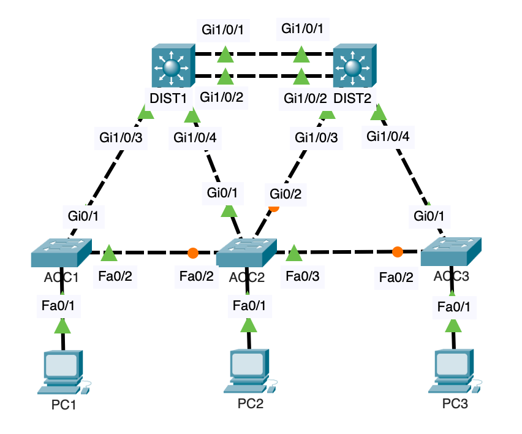
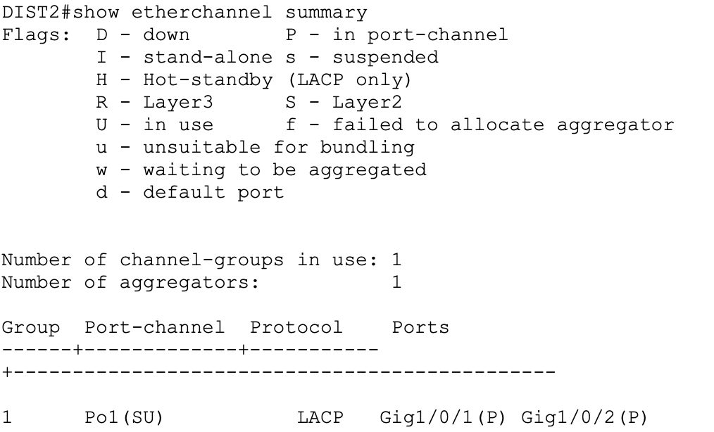
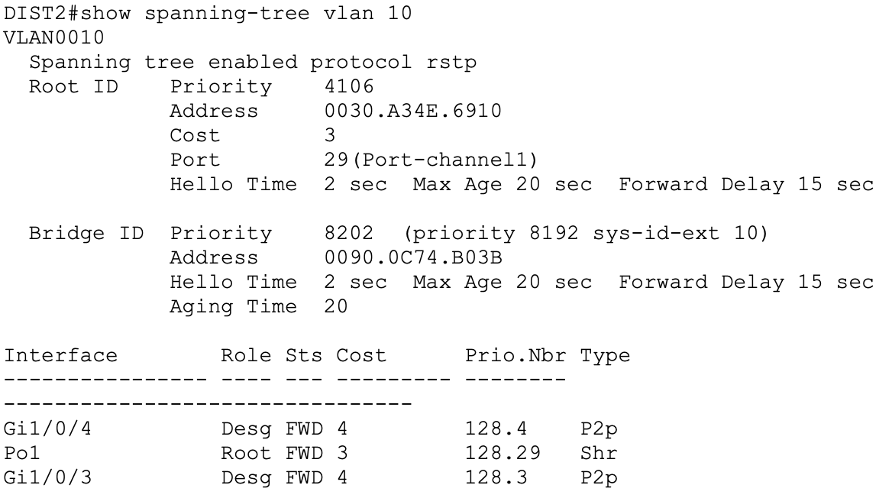
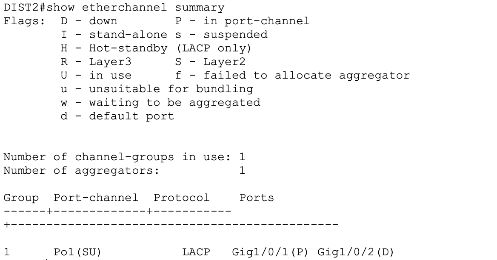

# EtherChannel and STP Redundancy Lab

## Overview

This lab demonstrates Layer 2 redundancy in an enterprise-style switching topology using Cisco Packet Tracer.

The network uses LACP EtherChannel between two distribution switches and Rapid PVST+ to prevent switching loops while maintaining redundant paths.

## Lab Objectives

- Configure LACP EtherChannel between distribution switches.
- Configure VLAN trunks for VLANs 10, 20, 30, and 99.
- Implement Rapid PVST+.
- Configure DIST1 as the primary STP root bridge and DIST2 as the secondary.
- Verify Layer 2 connectivity between access switches.
- Test EtherChannel resilience by disabling one member interface.
- Troubleshoot unexpected STP behavior.

## Network Devices

| Device | Role |
|---|---|
| DIST1 | Distribution switch, primary STP root |
| DIST2 | Distribution switch, secondary STP root |
| ACC1 | Access switch |
| ACC2 | Access switch |
| ACC3 | Access switch |
| PC1, PC2, PC3 | End devices for connectivity testing |

## VLAN Configuration

| VLAN | Name |
|---|---|
| 10 | USERS |
| 20 | SERVERS |
| 30 | GUEST |
| 99 | MANAGEMENT |

## EtherChannel Configuration

Two Gigabit Ethernet links connect DIST1 and DIST2 using LACP in active mode.

- Port-channel: Po1
- Protocol: LACP
- Member interfaces: Gi1/0/1 and Gi1/0/2
- Trunk VLANs: 10, 20, 30, 99

## Spanning Tree Configuration

Rapid PVST+ provides loop prevention and redundant path management.

- DIST1: primary root bridge
- DIST2: secondary root bridge

## Verification

The following commands were used:

```text
show etherchannel summary
show interfaces trunk
show spanning-tree vlan 10
show interfaces port-channel 1
```

EtherChannel verification confirmed that Po1 was operational and both physical interfaces were successfully bundled.

## Redundancy Testing

One EtherChannel member interface was administratively disabled to simulate a link failure.

**Result:** The port-channel remained operational through the remaining member, and connectivity between the PCs was maintained.

The disabled interface was subsequently restored, and both members returned to the port-channel.

## Troubleshooting Notes

During testing, Packet Tracer displayed inconsistent STP states, including physical EtherChannel member interfaces appearing separately in the spanning-tree output.

Controlled isolation tests confirmed that connectivity worked with EtherChannel disabled and with a single physical trunk.

After reopening the saved lab, the EtherChannel and STP behavior stabilized. The symptoms were consistent with a possible Packet Tracer simulation issue, although the exact cause was not conclusively established.

## Project Files

- `configs/` — Switch running configurations
- `topology/` — Cisco Packet Tracer lab file
- `screenshots/` — Verification and testing evidence

## Lab Screenshots

### Network Topology



### LACP Verification

Both physical interfaces are successfully bundled into Port-channel1 using LACP.



### Spanning Tree Verification

DIST1 is the primary root bridge for VLAN 10, and DIST2 reaches the root through Port-channel1.



### EtherChannel Failover Test

One EtherChannel member was administratively disabled to simulate a link failure. Port-channel1 remained operational through the remaining member, and end-to-end connectivity was maintained.



## Key Takeaways

This lab demonstrates practical LACP configuration, Rapid PVST+ operation, Layer 2 redundancy testing, and systematic troubleshooting of switching behavior.
