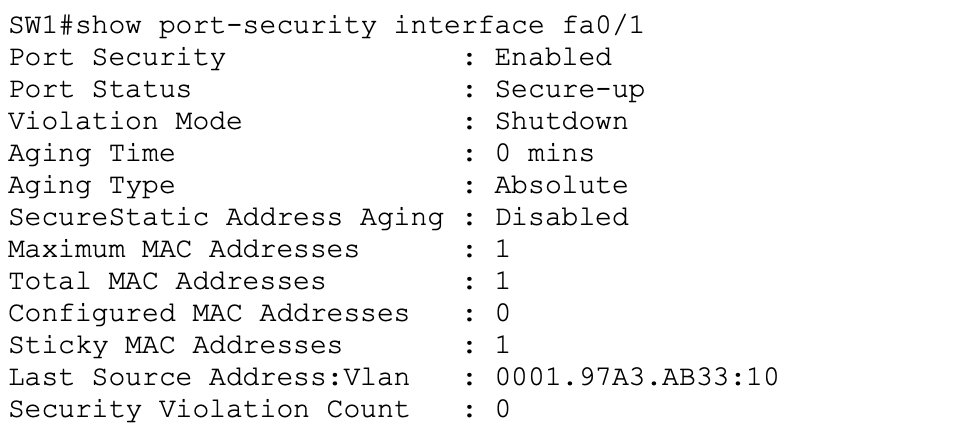
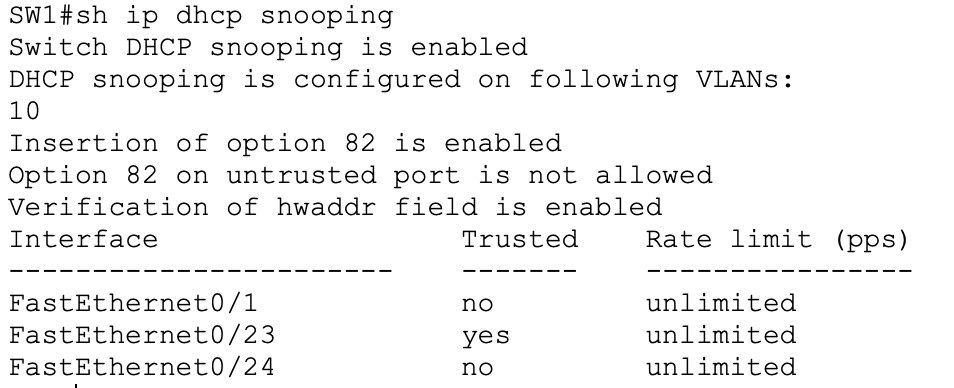
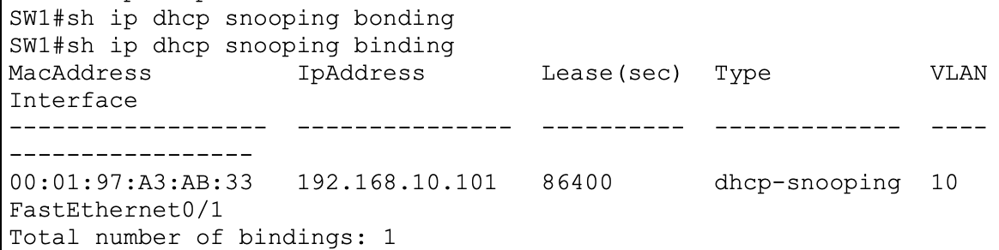
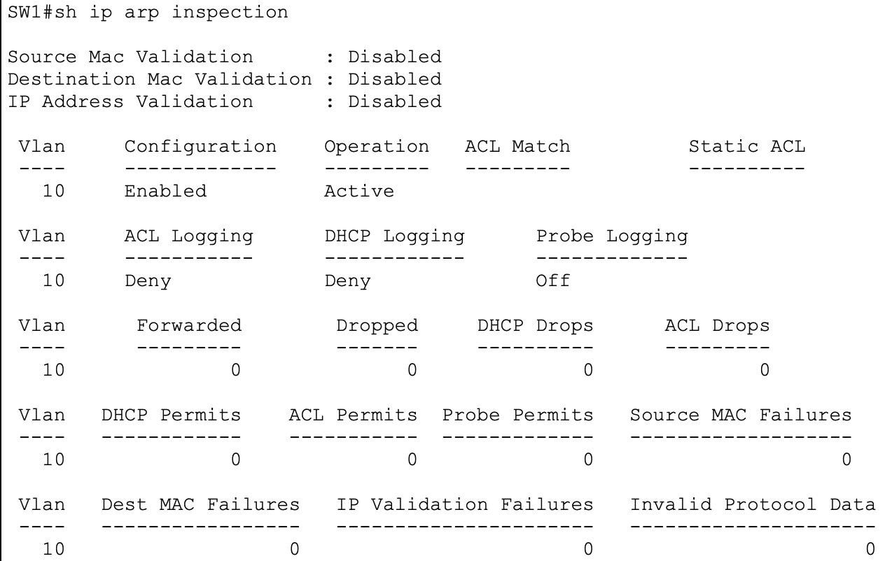

# Layer 2 Security Lab

**Cisco Packet Tracer | Cisco Catalyst 2960 | VLAN 10**

## Overview

This lab explores common Layer 2 access-switch security controls: **Port Security**, **PortFast and BPDU Guard**, **DHCP Snooping**, and **Dynamic ARP Inspection (DAI)**. The goal is to configure these protections, observe their behavior during controlled tests, and distinguish verified results from simulator limitations.

## Topology


The lab contains one Cisco 2960 switch (`SW1`), two client PCs, a legitimate DHCP server, and a rogue DHCP server. All endpoints use **VLAN 10 (USERS)**.

| SW1 interface | Connected device / purpose | Trust configuration |
| --- | --- | --- |
| Fa0/1 | DHCP client; Port Security test interface | DHCP Snooping untrusted; DAI untrusted |
| Fa0/2 | Second client / static-IP test | DHCP Snooping untrusted; DAI untrusted |
| Fa0/23 | DHCP-LEGIT (`192.168.10.2/24`) | DHCP Snooping trusted; DAI trusted |
| Fa0/24 | DHCP-ROGUE (`192.168.10.3/24`) | DHCP Snooping untrusted; DAI untrusted |

> Device positions and labels in the diagram are illustrative; the interface assignments above reflect the saved SW1 configuration and command output.

## Security features

### 1. Port Security

Port Security is enabled on **Fa0/1**, with a maximum of **one** learned MAC address, **sticky learning**, and **shutdown** as the violation action (the default).

```cisco
interface FastEthernet0/1
 switchport mode access
 switchport access vlan 10
 switchport port-security
 switchport port-security mac-address sticky
```

The switch learned `0001.97A3.AB33` on VLAN 10. The final verification reported **Secure-up**, one sticky MAC, and zero violations.

During earlier controlled testing, all three violation modes were exercised:

| Violation mode | Observed behavior |
| --- | --- |
| `shutdown` | Unauthorized MAC triggered `Secure-shutdown`; manual `shutdown` / `no shutdown` recovery was required. |
| `restrict` | Port remained up; violation counter increased. |
| `protect` | Port remained up; unauthorized traffic was suppressed without increasing the violation counter. |



### 2. PortFast and BPDU Guard

PortFast and BPDU Guard are enabled on **Fa0/1–Fa0/3**, which are designated access ports for end devices.

```cisco
interface range FastEthernet0/1 - 3
 spanning-tree portfast
 spanning-tree bpduguard enable
```

In an earlier test, connecting a switch to a BPDU Guard-enabled edge port caused a **BPDU Guard error-disable** event. After removing the test switch, the port was recovered manually. Port Security was temporarily disabled for that isolated BPDU Guard test to avoid confusing the two protections.

### 3. DHCP Snooping

DHCP Snooping is enabled globally and for **VLAN 10**. Only **Fa0/23**, connected to the legitimate DHCP server, is trusted.

```cisco
ip dhcp snooping
ip dhcp snooping vlan 10
!
interface FastEthernet0/23
 ip dhcp snooping trust
```

The legitimate DHCP pool allocated addresses from `192.168.10.100–149/24`. The rogue DHCP server was configured with a different pool (`192.168.10.200–219/24`) and a fake default gateway (`192.168.10.254`).

**Observed test:** With the legitimate server port administratively shut down, the client did **not** obtain a rogue DHCP lease and instead self-assigned an APIPA (`169.254.x.x`) address. Once Fa0/23 was restored, the client received a legitimate lease.

The binding table recorded:

| MAC address | IP address | VLAN | Interface |
| --- | --- | --- | --- |
| `00:01:97:A3:AB:33` | `192.168.10.101` | 10 | Fa0/1 |





### 4. Dynamic ARP Inspection (DAI)

DAI is enabled on **VLAN 10**, with **Fa0/23** configured as a trusted ARP inspection interface.

```cisco
ip arp inspection vlan 10
!
interface FastEthernet0/23
 ip arp inspection trust
```

The `show ip arp inspection` output reports **Configuration: Enabled** and **Operation: Active**. Optional source-MAC, destination-MAC, and IP-address validation checks are disabled.

**Validation limitation:** The Packet Tracer tests did not conclusively demonstrate the dropping of unauthorized ARP packets. Inspection counters remained at zero during the attempted tests, and a gratuitous ARP packet from a statically addressed client appeared to traverse the simulated network. Therefore, **DAI configuration and active status are verified, but effective ARP filtering is not claimed as validated**.



## Verification commands

```cisco
show port-security interface fa0/1
show ip dhcp snooping
show ip dhcp snooping binding
show ip arp inspection
show running-config
```

## Files

```text
03-layer2-security/
├── README.md
├── configs/
│   └── SW1.txt
├── screenshots/
│   ├── topology.png
│   ├── port-security.png
│   ├── dhcp-snooping.png
│   ├── dhcp-binding.png
│   └── dai-verification.png
└── packet-tracer/
    └── layer2-security.pkt
```

## Key takeaways

- **Port Security** restricts MAC addresses learned on access ports; violation mode determines the operational response.
- **BPDU Guard** protects edge ports from unexpected switch connections that send BPDUs.
- **DHCP Snooping** defines trusted DHCP-server-facing ports and records legitimate client leases.
- **DAI** can use DHCP Snooping bindings to validate ARP traffic, but simulator behavior must be tested before claiming that filtering works.
- Documenting **what was observed**, including limitations, is as important as documenting configuration commands.

## Environment

- Cisco Packet Tracer
- Cisco Catalyst 2960 (`SW1`)
- VLAN 10 (USERS)
