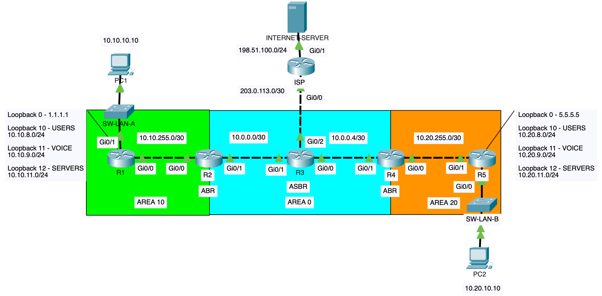

# Multi-Area OSPF Routing & Troubleshooting

## Project Overview

This project demonstrates the design, configuration, verification, and troubleshooting of a multi-area OSPF network in a simulated enterprise environment using Cisco Packet Tracer.

The network consists of five internal routers distributed across three OSPF areas, with Area Border Routers (ABRs) connecting non-backbone areas to Area 0 and an Autonomous System Boundary Router (ASBR) providing connectivity to an external ISP.

The lab focuses on scalable routing design, inter-area route summarization, external default-route propagation, OSPF Link-State Advertisements (LSAs), and systematic troubleshooting.

## Project Objectives

- Implement OSPFv2 across Areas 0, 10, and 20.
- Establish and verify OSPF neighbor adjacencies.
- Configure ABRs for inter-area connectivity.
- Implement inter-area route summarization.
- Configure an ASBR to advertise a default route.
- Examine OSPF intra-area, inter-area, and external routes.
- Analyze OSPF LSAs and routing-table behavior.
- Validate end-to-end connectivity between internal LANs and an external server.
- Diagnose and resolve common OSPF configuration failures.

## Network Topology

### Router Roles

| Device | Role | OSPF Areas |
|---|---|---|
| R1 | Internal Router | Area 10 |
| R2 | Area Border Router (ABR) | Areas 10 and 0 |
| R3 | Backbone Router / ASBR | Area 0 |
| R4 | Area Border Router (ABR) | Areas 0 and 20 |
| R5 | Internal Router | Area 20 |
| ISP | External Router | Outside OSPF |

### IP Addressing

| Network Segment | Subnet |
|---|---|
| LAN A | 10.10.10.0/24 |
| R1–R2 | 10.10.255.0/30 |
| R2–R3 | 10.0.0.0/30 |
| R3–R4 | 10.0.0.4/30 |
| R4–R5 | 10.20.255.0/30 |
| LAN B | 10.20.10.0/24 |
| R3–ISP | 203.0.113.0/30 |
| External Server Network | 198.51.100.0/24 |

## OSPF Design and Implementation

### Multi-Area Architecture

Area 0 provides the OSPF backbone and connects Areas 10 and 20 through ABRs R2 and R4.

OSPF process ID 10 is configured on the internal routers, with explicit router IDs and interface-level area assignments.

### Inter-Area Route Summarization

The ABRs aggregate contiguous networks to reduce the number of inter-area route advertisements.

**R2 — Area 10 summary**

`10.10.8.0/22`

**R4 — Area 20 summary**

`10.20.8.0/22`

Each summary covers four /24 networks, including the user LAN and three simulated networks represented by loopback interfaces.

OSPF advertises loopback interfaces as /32 host routes by default unless the OSPF network type is changed.

The summarization configuration reduces the number of inter-area prefixes advertised to other areas.

### External Default Route Propagation

R3 acts as an ASBR and maintains a static default route toward the ISP.

The command `default-information originate` injects the default route into OSPF, allowing internal routers to learn an external route marked `O*E2`.

External routing information is examined using Type-5 AS-External LSAs and, across area boundaries, Type-4 ASBR Summary LSAs.

## Verification and Testing

The following functionality was verified:

- OSPF neighbor relationships in FULL state.
- Intra-area and inter-area route learning.
- Successful aggregation of Area 10 and Area 20 prefixes.
- External default-route propagation from R3.
- Connectivity between LAN A and LAN B.
- Connectivity from internal hosts to the external server.

Detailed verification commands and results are available in [verification/verification.md](verification/verification.md).

## Troubleshooting Scenarios

Four configuration faults were deliberately introduced, diagnosed, and corrected:

| Scenario | Fault | Impact |
|---|---|---|
| 01 | OSPF Area Mismatch | Disrupted inter-area routing |
| 02 | Passive-Interface Misconfiguration | Lost OSPF adjacency |
| 03 | Missing OSPF Network Advertisement | LAN unreachable from remote areas |
| 04 | Default Route Propagation Failure | Lost external connectivity |

The troubleshooting process follows a structured methodology: symptom identification, verification, root-cause analysis, corrective action, and post-fix validation.

Detailed scenarios are documented in [troubleshooting/troubleshooting.md](troubleshooting/troubleshooting.md).

## Project Files

- [Cisco Packet Tracer Lab](multi-area-ospf.pkt) — Complete multi-area OSPF topology and configurations
- [Network Topology](topology.png) — Visual representation of OSPF areas, router roles, and network segments
- [Device Configurations](configs/) — Sanitized configurations for R1–R5 and ISP
- [Verification and Testing](verification/verification.md) — OSPF adjacencies, routing tables, LSA analysis, summarization, and connectivity validation
- [Troubleshooting Scenarios](troubleshooting/troubleshooting.md) — Four configuration faults, root-cause analysis, corrective actions, and validation

## Key Takeaways

This project demonstrates the importance of OSPF area design, ABR and ASBR functionality, route summarization, and external route propagation in enterprise routing environments.

It also highlights that operational OSPF adjacencies do not necessarily guarantee complete routing information, making routing-table inspection, LSA analysis, and end-to-end connectivity testing essential troubleshooting practices.

**Lab Environment:** Cisco Packet Tracer | Cisco IOS CLI | OSPFv2
