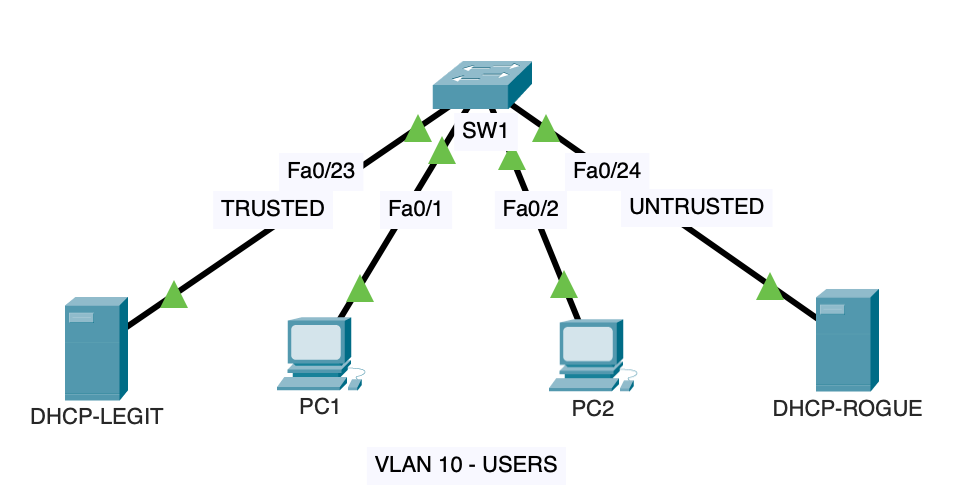

# Site-to-Site GRE over IPsec VPN with OSPF

## Project Overview

This project demonstrates the implementation of a secure site-to-site VPN connecting a Headquarters network and a Branch Office network through an ISP.

The solution combines three networking technologies:

- **GRE (Generic Routing Encapsulation)** to establish a logical tunnel between the sites.
- **IPsec (Internet Protocol Security)** to encrypt and protect GRE traffic.
- **OSPF (Open Shortest Path First)** to provide dynamic routing between the two LANs.

The lab was implemented and tested using Cisco Packet Tracer 8.2.0 and Cisco 2911 routers.

## Network Topology



## IP Addressing

| Device | Interface | IP Address | Description |
|---|---|---|---|
| R1 | G0/0 | 192.168.10.1/24 | Headquarters LAN |
| R1 | G0/1 | 203.0.113.1/30 | WAN |
| R1 | Tunnel0 | 10.10.10.1/30 | GRE Tunnel |
| ISP | G0/0 | 203.0.113.2/30 | Connection to R1 |
| ISP | G0/1 | 198.51.100.1/30 | Connection to R2 |
| R2 | G0/1 | 198.51.100.2/30 | WAN |
| R2 | G0/0 | 192.168.20.1/24 | Branch LAN |
| R2 | Tunnel0 | 10.10.10.2/30 | GRE Tunnel |
| PC1 | Fa0 | 192.168.10.10/24 | Headquarters PC |
| PC2 | Fa0 | 192.168.20.10/24 | Branch PC |

## Technologies Implemented

### 1. GRE Tunneling

A GRE tunnel was established between R1 and R2 using their WAN IP addresses.

GRE enables the transport of routing protocol traffic between geographically separated networks.

### 2. OSPF Dynamic Routing

OSPF Process ID 1 was configured on both routers.

The routers established an OSPF adjacency through the GRE tunnel in Area 0.

The Headquarters and Branch LAN networks were successfully advertised and learned dynamically.

### 3. IPsec VPN

IPsec was configured using IKEv1 and a pre-shared key for peer authentication.

The following security parameters were implemented:

| Parameter | Configuration |
|---|---|
| IKE Version | IKEv1 |
| Encryption | AES-128 |
| Hash | SHA-1 |
| Authentication | Pre-Shared Key |
| Diffie-Hellman | Group 2 |
| IPsec Protocol | ESP |
| IPsec Mode | Tunnel |
| IPsec Transform Set | esp-aes esp-sha-hmac |

**Security note:** SHA-1 and DH Group 2 are legacy algorithms used here for Packet Tracer compatibility and educational purposes. Modern production deployments should use stronger cryptographic settings.

### 4. Crypto ACL and Crypto Map

Extended ACLs were configured to identify GRE traffic between the WAN interfaces.

Crypto Maps were applied to the WAN interfaces of R1 and R2 to protect the GRE tunnel using IPsec.

## Verification and Testing

The following tests were successfully completed:

| Test | Result |
|---|---|
| WAN connectivity | PASS |
| GRE tunnel connectivity | PASS |
| OSPF neighbor adjacency | FULL |
| OSPF route exchange | PASS |
| Headquarters-to-Branch connectivity | PASS |
| IKEv1 negotiation | QM_IDLE / ACTIVE |
| IPsec Security Associations | ACTIVE |
| ESP encryption and decryption | PASS |

### OSPF Verification

The following command confirmed a successful OSPF adjacency:

```cisco
show ip ospf neighbor
```

Expected state:

```text
Neighbor ID    State      Address       Interface
2.2.2.2        FULL/-     10.10.10.2    Tunnel0
```

### IPsec Verification

IKEv1 negotiation was verified using:

```cisco
show crypto isakmp sa
```

The router reported:

```text
State: QM_IDLE
Status: ACTIVE
```

IPsec encryption was verified using:

```cisco
show crypto ipsec sa
```

Observed packet counters included:

```text
#pkts encaps: 30
#pkts encrypt: 30
#pkts decaps: 28
#pkts decrypt: 28
```

The encryption and decryption counters increased when additional traffic was generated between the Headquarters and Branch networks.

This confirmed that GRE traffic was being protected by IPsec.

## OSPF Reconvergence Observation

During IPsec activation, a temporary OSPF reconvergence was observed.

After several seconds, the OSPF adjacency returned to the FULL state, and connectivity between the two sites was restored.

A possible explanation is temporary GRE packet loss or delay during IKE/IPsec negotiation. The exact cause was not independently established.

## Key Learning Outcomes

This lab provided practical experience with:

- Building GRE tunnels between Cisco routers.
- Configuring OSPF over GRE.
- Implementing IKEv1 and IPsec.
- Configuring Crypto ACLs and Crypto Maps.
- Verifying active IPsec Security Associations.
- Confirming encryption through IPsec packet counters.
- Observing OSPF behavior during VPN activation.

## Tools and Environment

- Cisco Packet Tracer 8.2.0
- Cisco 2911 routers
- Cisco IOS 15.1(4)M4
- Cisco Catalyst switches
- Cisco IOS CLI

## Conclusion

The project successfully demonstrated a functional GRE over IPsec site-to-site VPN with OSPF dynamic routing.

Both sites exchanged routing information through the GRE tunnel, while IPsec provided encryption and protection for the encapsulated traffic.
